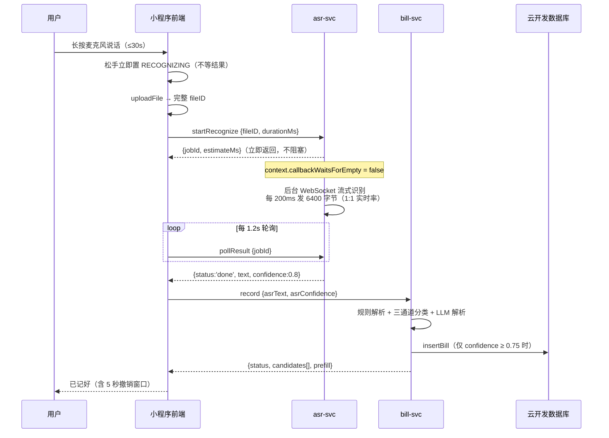
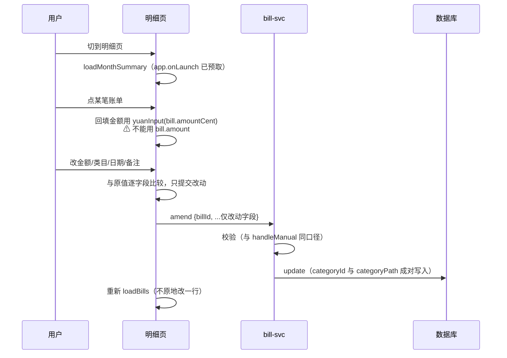
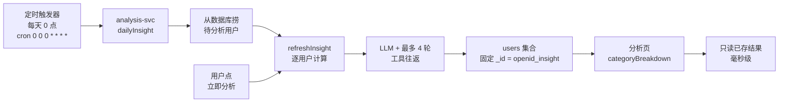
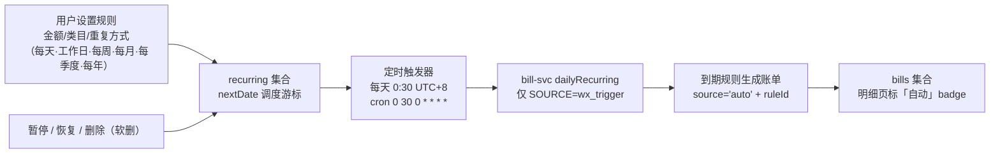
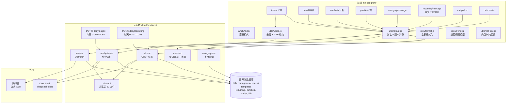

# 00 总览：随口记 voice-bill

> **一句话**：家庭语音记账微信小程序 —— 长按说一句话，自动解析金额/时间/类目并入账；支持重复记账规则到点自动入账；每天凌晨自动生成消费分析；登录自动注册，支持家庭模式共享账单（个人 + 家庭双空间）。
>
> **技术栈**：原生微信小程序（无框架）· 微信云开发（5 个云函数 + shared 共享层）· DeepSeek `deepseek-chat` · 腾讯云实时语音识别（WebSocket 流式）

## 1. 产品定位与边界

| 项 | 内容 | 出处 |
|---|---|---|
| 产品名 | 随口记 | `package.json:5` |
| 一句话定位 | 家庭语音记账小程序。说一句话，账就记好了 | `package.json:5` |
| 目标用户 | 持续记账 ≥ 1 个月的家庭用户 | `docs/prd-analysis-refactor-v3.md` §产品定位 |
| 运行时 | 微信小程序 + 微信云开发（无自建服务器） | `project.config.json` |
| 数据存储 | 云开发数据库，7 个集合（含历史遗留 templates；families/family_bills 为家庭模式新增） | `cloudfunctions/shared/util/constants.js:48-55` |

### 明确不做的事（非目标）

- ❌ **收入/结余/储蓄率分析** —— 产品是纯支出记账，无收入数据模型
- ❌ **预算达成率** —— 无预算功能
- ❌ **订阅清单 + 续费预告独立卡片** —— 留待下版本
- ❌ **改变「数值由代码计算」的架构原则** —— 这是模块立身之本

> 出处：`docs/prd-analysis-refactor-v3.md` §非目标。**架构原则不可动**是本项目最硬的约束。

## 2. 六大用户旅程

### 旅程 A：语音记账（主链路）



**关键设计**：
- **ASR 与记账解耦成两段**。`startRecognize` 立即返回 `jobId`，识别在云函数后台跑，前端轮询取结果。原因是 30 秒录音按 1:1 实时率发送音频本身就要 30 秒，同步等待必然超时。
- **ASR 的 `confidence` 恒为 0.8**（腾讯云流式不返回置信度），走「确认后入账」而非直接跳过确认 —— `cloudfunctions/asr-svc/index.js`。
- **前端不等待**：松手瞬间置 `RECOGNIZING`，保证 300ms 内有反馈。

### 旅程 B：明细与编辑



**三个易错点**（详见 `tech/13-frontend.md`）：
1. 回填必须用 `amountCent`（整数分），不是 `amount`（展示字符串 `"¥120.50"`）—— `Number("¥120.50")` = NaN
2. `categoryId` 与 `categoryPath` **必须成对写入**，统计侧完全靠 path 分组
3. 改了日期可能跨月 → 必须跳到新月份并明确提示

### 旅程 C：消费分析（读算分离）



**核心原则：分析要 10 秒，绝不能让用户等。**
分析页打开只读已落库结果（0ms），计算全部发生在定时任务或用户手动触发时。

### 旅程 D：自定义类目

三级联动选择器 + 关键词搜索 + 就地新建。**组件化**（`cat-picker` / `cat-create`），记账页与明细页编辑面板共用同一份 —— 复制一份就是第二个真相源。

### 旅程 E：重复记账（自动入账）



**口径（已与产品确认，实现于 `cloudfunctions/shared/util/recurring.js`）**：
- 创建当天**不生成**，游标从「明天起第一个匹配日」开始；漏跑**不补记**
- 编辑规则**仅对未来生效**，已生成的账单不动（可在明细页单独编辑）
- 当天已手工记过同类目同金额 → **照常生成**，不做智能去重
- 指定日当月不存在（2 月 30 日、平年 2 月 29 日）→ **跳过当月**；每季度 = 固定 1/4/7/10 月
- 幂等两道防线：游标前移 + 写入前查「同规则同日期」已有账单（`db.findBillByRuleAndDate`）

### 旅程 F：家庭共享（已实施，2026-11-01）


**关键口径（详见 `business/04-family-mode.md`）**：
- **双空间**：每笔账记入个人或家庭之一；家庭账本全员可见可记，分析按**当前账本**聚合
- **familyId 云端权威**：一律从 profile 反查，不信任前端；非成员 / 已退出 / 家庭解散 → 直接拒绝，**不回退个人账本**
- 家庭 insight 文档**顶层无 userId/month**（month 进 payload）—— 防止每日个人扫描污染与 owner 结论被静默压制
- 家庭分析 v1 **仅手动刷新**；定时家庭聚合与家庭规则共享留 v2

## 3. 全局架构



### 共享层（shared）是多副本，不是单一模块

`cloudfunctions/shared/` 是**源**，但每个云函数目录里还有一份**副本**（`cloudfunctions/<svc>/shared/`）。共有 5 份副本。

| 事实 | 影响 |
|---|---|
| 副本由 `npm run prepare:cf` 生成，排除 `node_modules`/`__tests__` | 改 shared 后**必须**跑同步 |
| 本地 mock 注入必须写 `globalThis` | 模块级变量跨副本不互通，只有全局能跨 |
| 云端加载路径优先 `__dirname/shared` | 见 `cloudfunctions/<svc>/index.js` 的 `loadShared()` |

> ⚠️ **本地全绿 ≠ 云端能跑。** 凡是只存在于本地 `node_modules` 的东西，云端一律看不到。

## 4. 技术实现索引

| 领域 | 文档 | 核心内容 |
|---|---|---|
| 业务规则 | `business/01-billing-rules.md` | ASR 解析、三通道分类、置信度三档、备注总结 |
| 业务规则 | `business/02-analysis-rules.md` | 刚性/弹性分档、节省建议口径、三道防线 |
| 业务规则 | `business/03-category-system.md` | 166 类目树、可压缩性、必需性消费 |
| 业务规则 | `business/04-family-mode.md` | 登录自动注册、双空间账本、邀请码加入、家庭分析 v1、四条铁律 |
| 技术 | `tech/10-architecture.md` | 5 云函数 action 全表、双定时触发器、部署四步、运行时限制 |
| 技术 | `tech/11-agent-harness.md` | 8 步调用链、11 工具、工具依赖校验 |
| 技术 | `tech/12-data-model.md` | 7 集合字段结构、金额单位约定、查询上限 |
| 技术 | `tech/13-frontend.md` | 页面 data 字段、utils 契约、组件事件、金额流向 |
| 工程 | `engineering/20-pitfalls.md` | 60+ 坑与防线 |
| 工程 | `engineering/21-debugging.md` | preflight / trace / 诊断 |
| 工程 | `engineering/22-roadmap.md` | PRD v3 规划（未实施） |
| 工程 | `engineering/23-change-impact.md` | **变更影响面索引 —— 改功能前先查** |

## 5. 术语表

| 术语 | 定义 |
|---|---|
| 刚性 / 半刚性 / 弹性 | 类目的可压缩性三档，决定它能否进入节省建议。见 `business/03-category-system.md` |
| 必需性消费 | 不该建议省的消费（通勤加油、社交人情）。省它伤的是关系不是钱 |
| 读算分离 | 分析页只读已落库结果，计算不在用户路径上跑 |
| 工具依赖校验 | 结论涉及的维度若没有对应工具被调用过 → 该条结论被剔除 |
| 三道防线 | 刚性白名单硬拦截 · 工具依赖校验 · 金额由代码兜底重算 |
| 降级语义 | `config`（用户能解决）/ `retry`（临时故障）/ `guard`（护栏正常工作，不是故障） |
| 置信度三档 | `≥0.75` 直接入账 · `≥0.4` 请求确认 · `<0.4` 引导手动选类目 |
| 强规则 | 金额通道命中且 `priority > 0` 的分类结论，会覆盖模型判断 |
| 兜底 | LLM 不可用时退回纯代码模板结论。四条路径全部有兜底 |
| 账本（ledger） | 记账与分析的分区：`personal`（个人）或 `family`（家庭）。缺省即 personal，切换记忆存 `wx.setStorageSync('ledger')` |
| 双空间 | 每笔账记入个人或家庭账本之一；家庭账本全员可见可记，分析按**当前账本**聚合 |
| 家庭（family） | `families` 集合一条记录；创建者即 owner，成员上限 8 人；家庭账单落 `family_bills` |
| 邀请码 | 8 位、排除易混字符 0/O/1/I，72 小时有效；仅 owner 可 regen（旧码立即失效） |
| 成员 | 加入家庭后的用户，以 `profile.familyId` 标记归属；非成员访问家庭数据一律拒绝 |

## 6. 全局铁律（改代码前必读）

### 6.1 数值计算铁律

> **所有涉及金额、比例、涨跌的计算，一律由代码完成，模型只负责表述。**

理由三条：模型加总不可靠；账单塞进 Prompt 会超 token；工具的数字能追到哪段代码算的，自由文本不能。

```
bills → normalizeBills → bill-stats.js（唯一算数字处）→ 结构化统计
      → insight agent（看不到账单，只看统计）→ 组织语言 → 校验（不过则退回兜底）
```

**约束**：
- 单位内部一律整数分，对外才转元
- **方向判断也是代码的事**（±1% 一律 `flat`）
- **模型拿不到原始账单**（`insight.agent.js` 的 `buildContext` 故意不注入）
- 工具参数尽量少（日期由代码锁定）
- 工具报错必须回传模型（模型唯一的自我修复途径）
- 必须有 `maxRounds`，每轮独立超时 `timeoutMs / maxRounds`

### 6.2 部署四步（改云函数代码必走）

| # | 动作 | 自动化 |
|---|------|--------|
| 1 | `shared/util/constants.js` 的 `CODE_VERSION` +1 | ✅ preflight |
| 2 | 同步 `miniprogram/utils/cloud.js` 的 `EXPECTED_CODE_VERSION` | ✅ preflight |
| 3 | `npm run prepare:cf` | ✅ 有脚本 |
| 4 | 开发者工具右键云函数 →「上传并部署：云端安装依赖」 | ❌ **只能人工** |

当前版本戳：`20261103-01`（`constants.js:183` / `cloud.js:21`）。

### 6.3 云端运行时限制

| 限制 | 说明 | 对策 |
|---|---|---|
| **没有全局 `cloud`** | 微信云函数运行时必须显式 `require('wx-server-sdk')` | 走 `shared/db/sdk.js` 的 `ensureSdk()` |
| **没有全局 `fetch`** | Node 18 的 fetch 只在 ESM 上下文注入，项目全用 CommonJS | 一律用 `shared/util/http-client.js` 的 `postJson()` |
| **没有内置 WebSocket** | 云函数是精简运行时 | 加 `ws` npm 依赖 |
| **shared 不进包** | 「云端安装依赖」不传本地 node_modules | shared 放函数目录内的**普通子目录** |

### 6.4 单一数据源原则

> **同一屏上出现的数字，绝不能来自两次独立计算。**

查一次 → 清洗一次 → 所有统计基于同一份快照。

### 6.5 金额单位必须写在名字里

同一份数据存两个字段、名字又长得像 → 早晚会传错。

| 语义 | 字段名 | 类型 |
|---|---|---|
| 计算值 | `amountCent` / `totalCent` / `dayTotal` | 整数分 |
| 展示值 | `amount` / `total` / `dayTotalText` | 字符串 |

⚠️ 展示值与计算值**不共名字段**。金额一律用字符串解析，不用浮点 —— `parseFloat('8.115')*100 = 811.4999…` → **811**，少一分。

## 7. 本 Wiki 的使用边界（实测结论）

> 这一节来自一次**双盲对照实验**：5 个真实变更需求，两组 agent 并行作答 —— A 组只准读 `docs/wiki/`，B 组只准读源码，互不可见。判据是 grep/node 实测过的事实。

### 7.1 结论一句话

> **Wiki 提供「判断」，源码提供「坐标」。缺任何一半都做不成事。**

| | 只读 Wiki | 只读源码 |
|---|---|---|
| 架构判断（该怎么做、有什么坑、要不要找产品确认） | ✅ **5/5 全对** | ⚠️ 会跑偏 |
| 口径纪律（数值铁律、读算分离、单一数据源） | ✅ 准确 | ⚠️ 需重新推导 |
| 与 PRD 非目标的冲突 | ✅ **只有 Wiki 组发现** | ❌ 需读 PRD |
| 定位坐标（常量在第几行、action 叫什么） | ❌ **大量推断错误** | ✅ 精确 |
| 发现既有代码与需求冲突（会红的测试） | ❌ **完全漏掉** | ✅ 全找到 |
| 发现隐含算法缺陷 | ❌ 漏 | ✅ 全找到 |

### 7.2 三个实测的反例

| 事实 | Wiki 组的推断 | 实测真相 |
|---|---|---|
| 单笔金额上限在哪 | 「应该在 constants.js，1 处」 | **4 处、3 种单位**：`constants.js:100`(元) / `money.js:100`(分,硬编码) / `bill-svc/index.js:71`(分,硬编码) / `bill-parse.schema.js:20`(元，实际宽松 10 倍) |
| 改「编辑面板」要动什么 | 没提任何测试 | **两条反向断言会直接让 CI 全红**：`tools/__tests__/edit-bill.test.js:93`、`tools/check-frontend.js:474` |
| 「12 万」能不能记账 | 没说 | **解析不出来** —— `cnToNumber` 单位表只到「千」，实测 `12万` → `amountCent=undefined` |

### 7.3 两轮实验的量化对比

同一个 5 场景实验，Wiki 从 4 页补到 10 页后重跑：

| 场景 | 第一轮（Wiki 4 页） | 第二轮（Wiki 10 页） | 源码组（参照） |
|---|---|---|---|
| 1 支付方式可编辑 | ≈90% | **≈85%** | 高 |
| 2 新增订阅维度 | ≈30% | **≈70%** | 中低 |
| 3 金额上限 | ≈60% | **≈95%** | 高 |
| 4 周期消费挪首页 | ≈25% | **≈55%** | 低 |
| 5 备注搜索 | ≈50% | **≈80%** | 中高 |
| **可独立落地数** | **1.5 / 5** | **3 / 5** | 3 / 5 |

**补 6 页把 Wiki 从「只能定方向」提升到「能独立落地多数场景」。**

### 7.4 失败模式变了 —— 这是最值得注意的一点

| | 第一轮的失败模式 | 第二轮的失败模式 |
|---|---|---|
| 症状 | 「找不到文件」「坐标猜错」 | 「**Wiki 覆盖范围内找不到口径定义**」 |
| 例子 | 金额上限猜成 1 处 | 「什么算订阅」无定义 |
| 修法 | 补 `file:line` 索引 | 只能找产品/源码确认 |

> **含义**：Wiki 已经能可靠回答「改哪里、怎么改、踩什么坑」。
> 剩下的阻塞点全是**产品口径**（订阅怎么定义、续费日从哪来、搜哪几个月）——
> 这类问题**本就不该由 Wiki 回答**，写进 Wiki 反而会变成臆造。

### 7.5 正确用法

| 场景 | 建议 |
|---|---|
| 接需求 / 估工作量 | ✅ **先读 Wiki** —— 判断题全对，能避免大部分方向性错误 |
| 动手改 | ✅ 读 Wiki 定方向 + 拿到坐标 → **grep 复核关键行号** → 改 → 跑测试 |
| review / 排查线上问题 | ✅ Wiki 直接给出「这条链路上有哪几个已知坑」 |
| 纯找文件位置 | ❌ 别读 Wiki —— grep 更快更准，Wiki 在这上是负收益 |
| 定义产品口径 | ❌ **别问 Wiki** —— 「什么算订阅」这类问题 Wiki 没答案（也不该有），直接找产品 |

**最优流程**：Wiki（判断 + 坐标）→ grep（复核 + 补 Wiki 没覆盖的）→ 改 → `npm test` + `npm run preflight`（守卫）。

> Wiki 的坐标会随代码变动而失效 → **行号引用只作佐证，动手前 grep 复核一遍**。

### 7.6 变更前必查

**`engineering/23-change-impact.md`** —— 改功能前先查这页：哪些文件会连动、哪些测试会红、哪些地方会静默失效。

本项目最大的坑不是「找不到文件」，是**找到了但漏了一处**：同一常量散在 4 处、同一份数据存两个字段、同一件事在 3 条路径上各有一份实现。

## 8. 版本与现状声明

| 项 | 值 |
|---|---|
| 代码版本戳 | `20261103-01` |
| 重复记账 | 6 种模式（每天/工作日/每周/每月/每季度/每年），定时 0:30 自动入账（**已实施**） |
| 家庭模式 | 登录自动注册 + 双空间账本 + 邀请码加入 + 家庭分析 v1 手动刷新（**已实施**）；家庭定时聚合/规则共享留 v2（**规划中**） |
| 分析 Agent 版本 | `insight` agent v3（省钱建议全 AI 化，**已实施**） |
| 分析窗口 | `ANALYSIS_MONTHS = 6`（近 6 个月，不含同比） |
| 预置类目 | 166 个（12 一级 / 45 二级 / 109 末级） |
| 分析工具 | 11 个 |

> ⚠️ **易混淆点**：`insight.agent.js` 的 **agent v3**（已上线）≠ `docs/prd-analysis-refactor-v3.md` 的 **PRD v3**（未实施）。后者要加同比/异常检测/消费节奏，详见 `engineering/22-roadmap.md`。
