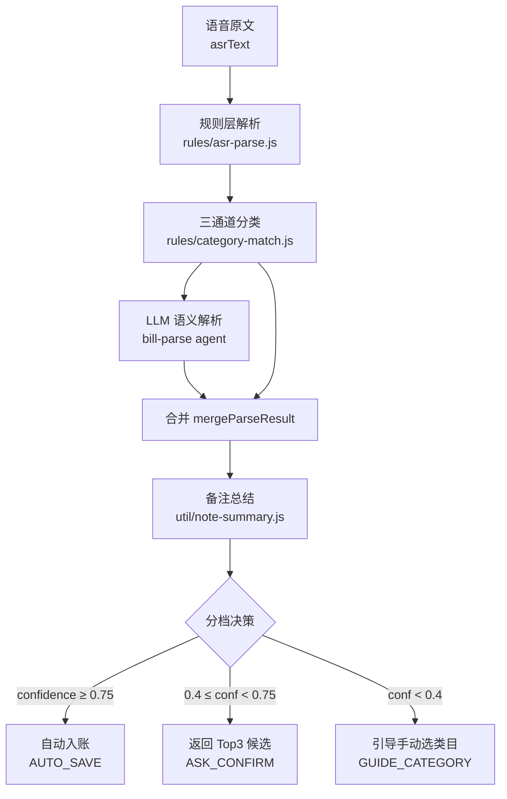

# 01 记账业务规则

> 覆盖：语音原文 → 金额/时间/账户/场景抽取 → 三通道分类 → 置信度分档 → 备注总结 → 落库/确认/引导。
>
> 权威实现：`cloudfunctions/bill-svc/index.js`（1574 行）、`cloudfunctions/shared/rules/`、`cloudfunctions/shared/agent-harness/`。

## 1. 处理流水线



| 阶段 | 实现 | 职责 |
|---|---|---|
| ① 参数校验 | `bill-svc/index.js` | `asrText` 非空；拿不到 openid **直接抛错中止**（不写 `userId='unknown'` 脏数据） |
| ② 规则解析 | `shared/rules/asr-parse.js` | 抽金额/账户/时间/场景/拆句 |
| ③ 三通道分类 | `shared/rules/category-match.js` | 关键词 + 金额 + 语义，融合出 Top3 |
| ④ LLM 解析 | `shared/agent-harness/` | 补规则抽不到的字段（场景、备注） |
| ⑤ 合并 | `bill-svc/index.js` `mergeParseResult` | 规则与模型结果融合 |
| ⑥ 备注总结 | `shared/util/note-summary.js` | 决定最终 `note` |
| ⑦ 分档决策 | `shared/agent-harness/confidence.js` | 决定入账/确认/引导 |
| ⑧ 落库 | `shared/db/index.js` `insertBill` | `userId` 强制取 `getWXContext().OPENID` |

## 2. 规则层：ASR 解析

`shared/rules/asr-parse.js` 输出：

```js
{
  amount,          // 整数分
  amountCertain,   // 布尔：金额是否明确
  amountPattern,   // 命中的模式名
  timeType,        // today|yesterday|dayBefore|lastWeek|specific|none
  date,            // 'YYYY-MM-DD'
  account,         // wechat|alipay|cash|card|unknown
  scenes[],        // unit|friends|child|spouse|elder|treat|celebration|medical|travel|school
  splitCount,      // 一句话说了几笔
  splitParts[],
  source: 'rules'
}
```

### 2.1 金额抽取：7 种模式，按优先级

| 优先级 | 模式名 | 示例 | 解析结果 |
|---|---|---|---|
| 1 | `arabic_cny_fen` | 买菜 100 元 5 毛 | 10050 分 |
| 2 | `arabic_with_unit` | 菜市场 68 块 5 | 6850 分 |
| 3 | `arabic_bare` | 打车 35 | 3500 分 |
| 4 | `chinese_cny_fen` | 三块五毛五 | 355 分 |
| 5 | `chinese_with_unit` | 三百八十 | 38000 分 |
| 6 | `chinese_bare` | 一百五（口语省略单位） | 15000 分 |
| 7 | `vague` | 四十来块 | **`certain: false`** |

**`vague` 是关键**：`amountCertain === false` 时，后续分档决策会**强制降级为需要确认**，并置 `amountFirst: true`，UI 文案「金额不明确，请确认金额」。

中文数字支持「千二 = 1200」「百五 = 150」（`shared/util/money.js` 的 `cnToNumber`）。

### 2.2 时间抽取

| 输入 | `timeType` | 解析日期 |
|---|---|---|
| 昨天买 | `yesterday` | 昨天 |
| 前天 | `dayBefore` | 前天 |
| 三天前 | `specific` | 今天 - 3 天 |
| 上周三 | `lastWeek` | 上周对应星期 |
| 无时间词 | `today` | 今天 |

### 2.3 账户抽取

| 输入 | `account` |
|---|---|
| 微信付的 | `wechat` |
| 支付宝 | `alipay` |
| 刷卡 | `card` |
| 现金 | `cash` |
| 无 | `unknown` |

## 3. 三通道分类引擎

`shared/rules/category-match.js`

```js
classify(text, amountYuan, semanticCandidates = [], customCategories = [])
// → { candidates[Top3], topCategoryId, hitAllMiss, channelStats }
```

### 3.1 通道与权重

| 通道 | 权重 | 得分区间 | 说明 |
|---|---|---|---|
| 关键词 | **0.5** | 0.5 ~ 0.95 | `0.5 + specificity * 0.45` |
| 语义 | **0.3** | 模型给分 | LLM 返回的候选 |
| 金额 | **0.2** | 见下表 | 14 条金额规则 |

**自定义类目与预置末级同权参与关键词通道** —— 用户建的「狗狗美容」和预置的「买菜」一样被搜。

### 3.2 金额通道的 14 条规则（节选）

| 条件 | 类目 | score | priority |
|---|---|---|---|
| 打车 + 医疗词 | 门诊挂号 | 0.85 | **10** |
| 学费 / 保育费 | 学费 | 0.9 | — |
| 高铁 / 飞机 / 火车 | 高铁飞机 | 0.9 | — |
| 地铁 / 公交 + <50 元 | 地铁公交 | 0.85 | — |
| 打车 + <100 元 | 打车 | 0.8 | 0 |
| 下馆子 / 聚餐 + ≥150 元 | 聚餐宴请 | 0.85 | — |
| 超市 + 生鲜线索 | 买菜 | 0.85 | — |
| 超市 / 商场（无细分） | 纸巾清洁 | **0.55** | — |
| 米面粮油 | 米面粮油 | 0.85 | — |

**强规则置顶机制**：`priority > 0` 的命中项直接置顶；仅由关键词支撑的项 `score *= 0.5` 降权。

### 3.3 强规则会覆盖模型判断

若规则层 Top1 命中了 `priority > 0` 的强规则、而模型 Top1 不同：

```
→ 强制 tier = 'mid'、action = 'ASK_CONFIRM'
→ UI 文案「已按场景规则归类，请确认」
→ tracer 记录 strong_rule_override
→ 置信度封顶 0.74（绝不自动入账）
```

> 典型用例：「打车去医院 45」。规则层判「门诊挂号」（priority 10），模型可能判「打车」。**强规则优先，但必须让人确认** —— 置信度封顶 0.74 意味着走确认而非自动入账。

**自定义类目置顶同理**：规则层 Top1 是用户自建类目、模型没给时，也降级为确认，文案「已按你的自定义类目归类，请确认」。

### 3.4 不压过强规则

用户自建「宠物」类目，**不会**让「打车去医院 45」变成宠物医疗 —— 强规则场景下自定义类目仍保留在候选里（用户可以改选），但不排第一。

## 4. 置信度三档

`shared/agent-harness/confidence.js`

### 4.1 融合公式

```js
const W = { MODEL: 0.5, RULE: 0.3, REPAIR: 0.2 };

s = 0.5 * clamp(topScore)
  + 0.3 * ruleConsistency(ruleMatch)   // 一致=1.0，矛盾=0，其他=0.4
  - 0.2 * 0.2 * repairCount
  → clamp(s, 0, 1)
```

**检测到幻觉直接归零**：`if (hasHallucination) return 0;`

### 4.2 分档与动作

| 置信度 | tier | action | status | 前端行为 |
|---|---|---|---|---|
| ≥ **0.75** | high | `AUTO_SAVE` | `saved` | 直接入账，显示 5 秒撤销 |
| ≥ **0.4** 且 < 0.75 | mid | `ASK_CONFIRM` | `needConfirm` | 展示 Top3 候选卡片 |
| < **0.4** | low | `GUIDE_CATEGORY` | `needCategory` | 引导手动选类目 |

阈值定义在 `shared/util/constants.js:6-9` 的 `CONFIDENCE`。

### 4.3 兜底置信度上限 0.74

LLM 故障走规则兜底时，置信度**上限 0.74** —— 绝不给到高置信度。

> 理由：LLM 故障时模糊场景若自动入账，用户看到「记好了」但类目是错的。**宁可让用户多点一次。**
> 计算：`strong rule → min(0.7 + asrConf*0.1, 0.74)`；普通规则 → `min(base + asrConf*0.2, 0.74)`

### 4.4 模糊金额保护

`amountCertain === false` 时，无论置信度多高都**强制降级为需要确认** + `amountFirst: true`。

## 5. 备注总结

`shared/util/note-summary.js` 的 `buildNote({ asrText, llmNote })` —— 三条路径：

| 路径 | 条件 | 结果 |
|---|---|---|
| ① | LLM 总结可用**且没丢关键词** | 用总结（≤ 30 字） |
| ② | LLM 总结可用**但丢了关键词** | **退回原话全文**（≤ 200 字） |
| ③ | LLM 不可用 / 没给摘要 | **退回原话全文**（≤ 200 字） |

### 5.1 关键词不能丢

关键词表集中在 `shared/util/note-keywords.js`（**单一数据源**，被 compressibility / essential-spend / note-summary 三处共用）：

| 词表 | 数量 | 示例 |
|---|---|---|
| `RIGID_NOTE_KEYWORDS` | 14 | 学费、房租、房贷、保费、利息、物业费、奶粉、尿布、药、看病、住院、保险、宽带、税 |
| `ESSENTIAL_NOTE_WORDS` | 11 | 通勤、上班、必需、必须、刚需、孩子学费、水电、油费、加油 |
| `SOCIAL_NOTE_WORDS` | 12 | 聚餐、请客、随礼、份子钱、红包、聚会、生日、满月、婚礼、乔迁、看望、人情 |
| `SCENE_LABELS` | 10 | unit 单位聚餐、friends 朋友聚会、child 孩子相关… |

### 5.2 为什么丢了关键词就退回原文

> 模型把「孩子学费 3200」总结成「教育支出」→ 刚性判定失效 → 分析页建议「学费省 30%」。
> **这是本项目最贵的事故类型。**

检测到丢词就**退回原文，不拼接** —— 拼接出来像机器拼的故障。

### 5.3 兜底路径备注里带金额

「买菜 100」的备注是「买菜 100」，不是「买菜」。这是需求明确要求的取舍：**明细页金额是独立字段，不参与计算，不会算错。**

## 6. 落库

### 6.1 账单文档结构

```js
{
  userId,          // db.insertBill 强制用 getWXContext().OPENID 覆盖
  amount,          // 整数分
  categoryId,
  categoryPath,    // '餐饮/外出就餐/火锅烧烤' ← 统计侧完全靠这个分组
  date,            // 'YYYY-MM-DD'
  ts,
  account,
  note,            // 统一裁到 200 字
  source,          // voice|auto|recall|manual
  isRecall,        // source === 'recall'
  recallDaysLater,
  aiMeta: { agent, isFallback },
  confidence,
  delFlag: false,
  createTime, updateTime
}
```

> ⚠️ **云开发数据库无 schema**，字段不存在没问题，但 **null 值在部分环境会触发写入异常** → 无值时**直接不写该字段**，而不是写 null。

### 6.2 落库失败不假装成功

```js
{ saved: false, savedError, status: 'needConfirm',
  action: 'ASK_CONFIRM', ui: '记账未保存，请检查网络后重试' }
```

前端检查 `res.saved === false`（**不能只看有没有抛异常**）→ 显示错误条 + 仍列出 Top3 候选供改类目重试。

> 此前直接展示「✓ 记好了」，用户看到成功反馈但刷新后数据消失 —— **比直接报错更糟，因为用户不会去排查。**

### 6.3 撤销：软删除

5 秒撤销窗口 → `amend { billId, delFlag: true }` → `update({ delFlag: true, updateTime })`。记录不删除，只标记。

## 7. 编辑账目（amend）

### 7.1 字段边界

| 可编辑 | 不可编辑 |
|---|---|
| 金额、类目、日期、备注 | userId、source、isRecall、confidence、aiMeta、createTime |

**不含支付方式** —— 用户明确不需要。

### 7.2 三条硬规则

1. **`categoryId` 与 `categoryPath` 必须成对写入**。且**不信任前端传的 path** —— 预置类目一律按 id 反查（`preset.pathOf(id)`），自定义类目（不在预置库）沿用前端传的。
2. **校验必须与 `handleManual` 同口径**：金额正数/整数分/不超上限、日期格式、**拒绝未来日期**、账户枚举、备注长度 ≤ 200。
   > ⚠️ **校验必须写在「本地环境跳过落库」的早退之前** —— 否则本地测试全走早退分支，校验一次都没执行过。
3. **前端只提交真正改动过的字段**。全量提交会有两个问题：用户自定义类目 id 不在预置库里 → 云端反查不到 path 可能拒绝这次编辑；没改的字段会白写一次。

### 7.3 过期判定必须含 updateTime

编辑只改 `updateTime`（不动 `createTime`）。判据统一为：

```js
max(createTime, updateTime)
```

**定时任务与页面的判据必须一致** —— 否则分析结论该过期时不过期。

## 8. 输入方式：三种入账路径

| 路径 | 云函数 action | LLM | confidence | 说明 |
|---|---|---|---|---|
| 语音 | `record` | ✅ | 模型算 | `source = 'voice'` |
| 文字 | `record` | ✅ | 硬编码 0.9 | 复用同一 AI 链路，`parseText()` |
| 直填 | `manual` | ❌ | 恒为 1 | 跳过 LLM，`source = 'manual'` |

**`manual` 独立于 `recall`** —— recall 会打 `isRecall` 标记，污染补记转化率埋点。

**`recall` 一律给候选，绝不自动入账**（事后补记，日期由用户选）。

## 9. 账本归属（双空间，已实施 2026-11-01）

4 个入账/编辑 handler（`record` / `recall` / `manual` / `amend`）接受可选 `ledger` 参数，入口统一走 `resolveLedger(payload, context)`（`bill-svc/index.js:1554`）：

| ledger | 落库 | 行为 |
|---|---|---|
| 缺省 / `'personal'` | `bills` | **原路径零新增查询**（铁律：默认路径不查 profile，`test-persist`/e2e mock 无 `doc()` 会崩） |
| `'family'` | `family_bills` | 反查 `profile.familyId`（`db/index.js:386`）→ 校验家庭存在且是成员 → 写账单（`insertFamilyBill`，`db/index.js:691`）；**familyId 为空 → throw，不回退个人** |
| 其他值 | — | throw `未知账本类型` |

- **familyId 云端权威**：一律从 profile 文档反查，不信任前端传值
- 家庭账单 `userId` = 记录人；`amend`/撤销的 where 仍带 `userId: openid` —— **只有记录人能编辑/撤销自己的账**（`softDeleteFamilyBill`，`db/index.js:755`）
- 家庭账单结构 = bills 同构 + `familyId`，前端 `groupByDate` 白名单无需改动
- 重复记账规则同样支持账本区分（已实施 2026-11-01，`20261101-03`）：规则文档带 `ledger`（`'personal'` 缺省 \| `'family'`）+ `familyId`（仅家庭规则，云端反查）；家庭规则定时生成的账单进 `family_bills`，`userId` = 规则创建者 = 记录人。口径：**规则私有不共享**；**退出/解散家庭时自动暂停**该成员家庭规则；**账本归属创建后不可改**（换账本删除重建）。详见 `business/04-family-mode.md` §9

详见 `business/04-family-mode.md` §4。
