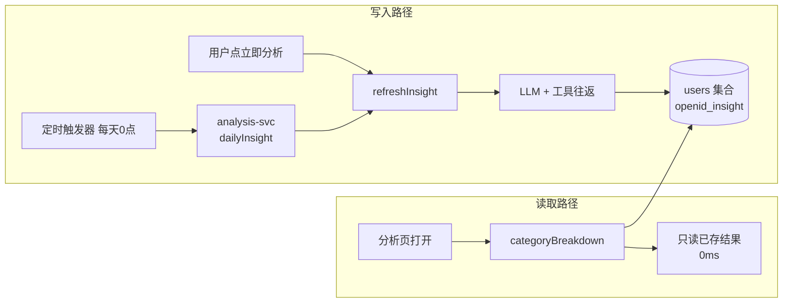

# 02 分析业务规则

> 覆盖：读算分离 · 刚性/半刚性/弹性 · 必需性消费 · 节省建议口径 · 结论依据 · 降级语义 · 四种结果状态。
>
> 权威实现：`cloudfunctions/analysis-svc/index.js`（1032 行）、`cloudfunctions/shared/agent-harness/`、`cloudfunctions/shared/util/category-compressibility.js`、`essential-spend.js`。

## 1. 核心原则：读算分离

> **分析要 10 秒，绝不能让用户等。**



| 动作 | action | 是否跑 LLM | 耗时 |
|---|---|---|---|
| 打开分析页 | `categoryBreakdown` | ❌ | 毫秒级 |
| 点「立即分析」 | `refreshInsight` | ✅ | 约 25 秒 |
| 每天 0 点批量 | `dailyInsight` | ✅ | 批量，每批 32 秒预算 |

**`categoryBreakdown` 绝不触发计算** —— 读算分离的全部意义在此。

### 1.1 分析窗口

```js
const ANALYSIS_MONTHS = 6;      // 本月 + 环比上月 + 趋势回溯 6 个月
const TOTAL_BUDGET_MS = 32000;  // dailyInsight 内部预算，留 8 秒余量
```

> ⚠️ **当前只有 6 个月窗口，没有同比。** PRD v3 要求扩到 13 个月以支持同比 —— **尚未实施**，见 `engineering/22-roadmap.md`。

## 2. 刚性 / 半刚性 / 弹性

`shared/util/category-compressibility.js`（183 行，**单独成文件**，不写进 `category-preset`）

| 档位 | 语义 | 在建议中的待遇 |
|---|---|---|
| `rigid` | 刚性 —— 房租、学费、药品、物业、保费、宽带、奶粉 | **禁止出现在任何节省建议里** |
| `semi` | 半刚性 —— 日用品、衣物、部分会员 | 可提，但要克制，不建议「砍零」 |
| `flexible` | 弹性 —— 娱乐、零食、外食 | 真正的优化对象 |

### 2.1 刚性类目清单（17 个）

| 一级 | 类目 ID |
|---|---|
| 居住 | `c9_1_1` 房租房贷 · `c9_2_1` 物业费 · `c9_3_1` 水电燃气 |
| 育儿教育 | `c4_2_1` 学费 · `c4_2_2` 补习班 · `c4_3_1` 奶粉 · `c4_3_2` 零食辅食 |
| 医疗健康 | `c5_1_1` 门诊挂号 · `c5_1_2` 药品 · `c5_1_3` 体检 · `c5_1_4` 疫苗 · `c5_1_5` 牙科 · `c5_1_6` 眼科配镜 |
| 金融保险 | `c10_1_1` 保险保费 · `c10_2_1` 贷款利息 |
| 通讯网络 | `c8_1_1` 话费流量 · `c8_2_1` 宽带 |

### 2.2 半刚性类目清单（14 个）

| 一级 | 类目 ID |
|---|---|
| 居家生活 | `c3_1_1` 纸巾清洁 · `c3_1_2` 厨房用品 · `c3_1_3` 收纳 · `c3_1_4` 卫浴用品 · `c3_3_1` 家具 · `c3_3_2` 床上用品 · `c3_3_3` 厨具 |
| 育儿教育 | `c4_1_4` 校园用品 |
| 服饰美容 | `c6_1_1` 衣物 · `c6_1_2` 鞋帽 |
| 通讯网络 | `c8_3_1` 视频会员 · `c8_3_2` 音乐会员 · `c8_3_3` 云盘会员 · `c8_3_4` 会员购 |

**半刚性的原始理由**（源码注释）：「典型：日用品（纸巾会消耗）、宠物（饲料必须买）、通讯套餐里的超额流量（有上限）、衣物（要买但不急）。」

### 2.3 ⚠️ `c4_3_2 零食辅食` 的注释与实现不一致

`RIGID_IDS` 里有 `c4_3_2`，但旁边的注释写「（半刚性，见下方说明）」。

**实际实现按刚性处理** —— `compressibilityOf` 先查 `RIGID_IDS.has(id)`，命中即返回 `RIGID`：

```js
if (RIGID_IDS.has(id)) return LEVEL.RIGID;
if (SEMI_IDS.has(id)) return LEVEL.SEMI;
```

### 2.4 备注关键词兜底

```js
function isRigidBill(bill) {
  const level = compressibilityOf(bill && bill.categoryId);
  if (level === LEVEL.RIGID) return true;
  const note = String((bill && bill.note) || '');
  if (!note) return false;
  return RIGID_NOTE_KEYWORDS.some((k) => note.includes(k));
}
```

> 理由：**用户的手动记账经常选错类目，类目不该是唯一依据。**

### 2.5 为什么必须排除刚性

> 实测：学费 2000 → 省 600 / 房租 3500 → 省 1050，**数学全对但结论全错 —— 这些省不动。**

### 2.6 三个实施要点

| # | 要点 |
|---|---|
| ① | **单独成文件**，不写进 `category-preset` |
| ② | **备注关键词兜底**（用户选错类目时仍能识别） |
| ③ | **刚性不占建议名额** —— 顺序必须是：**先剔刚性 → 再判笔数 → 最后截断** |

## 3. 必需性消费：备注存在 ≠ 该省

`shared/util/essential-spend.js`（85 行）

```js
function isEssentialSpend(bill)  // true = 不该建议省
```

### 3.1 判定顺序

| 顺序 | 判据 | 命中结果 |
|---|---|---|
| 1 | 末级类目名在 `ESSENTIAL_LEAF_NAMES`（42 个） | 必需 |
| 2 | 备注含 `ESSENTIAL_NOTE_WORDS` | 必需 |
| 3 | 备注含 `SOCIAL_NOTE_WORDS` | 必需 |

### 3.2 必须精确到末级

> 「必须精确到末级（加油 vs 旅游度假），因为同一一级类目下既有必需的也有可选的。用一级判定会误伤。」

42 个末级类目名按域分组：

| 域 | 类目名 |
|---|---|
| 交通 | 加油、油费、打车、出租车、地铁、公交、公共交通、高铁、火车票、飞机票、车票、加油费 |
| 食品 | 买菜、肉蛋、水产、蔬菜、水果、粮油、生鲜、米面、食品 |
| 居住 | 水电燃气、电费、水费、燃气费、取暖费、物业费、房租房贷 |
| 通讯 | 话费流量、宽带 |
| 医疗 | 药费、药品、看病、门诊挂号、门诊、住院 |
| 育儿 | 奶粉、纸尿裤、尿布 |
| 金融 | 保费、保险保费、贷款利息 |

### 3.3 社交支出也算必需

> 「『同事聚餐』『请客』『随礼』这类开销，金额确实可以少花，但建议用户少请客、少随礼是不合适的 —— **它伤的是关系，不是理财**。这类支出的正确说法是『这笔是一次性事件，不用每月都花』，而不是『省 X 元』。」

**测试验证**（`saving-rules.test.js`）：
- 通勤加油是必需消费，不该建议省 ✅
- 买菜是必需消费 ✅
- **社交聚餐是必需支出（省它伤的是关系）** ✅
- 随礼、红包同理 ✅
- 买外套是可选消费，可以建议 ✅
- 旅游是可压缩的（与加油区分）✅
- 备注含「通勤」也算必需（类目可能选错）✅

## 4. 节省建议的口径

### 4.1 v3 的根本变化

| | v2 | v3（当前） |
|---|---|---|
| 建议来源 | 规则算：占比 ≥15% + 单类目 ≥3 笔 + 金额代码重算 | **模型基于逐笔明细自由分析** |
| 典型失败 | 用户记 5 笔账、餐饮占 42.6% → 「暂时没有可优化空间」 | — |
| 金额 | 代码算、模型转述 | 模型估，prompt 约束口径；纯定性建议 `amount` 可为 null |

### 4.2 建议的五个视角

来自 `insight.agent.js` 的 prompt：

| # | 视角 | 要点 |
|---|---|---|
| 1 | **频次** | 「买衣服 4 次、间隔 6 天，频次偏高」 |
| 2 | **品牌与档次** | 「备注都是快消品牌，基础款平替能省一半」 |
| 3 | **订阅审视** | 周期性订阅类的重复支出 |
| 4 | **单笔大额 ≠ 习惯** | 一笔 800 元冲动消费，不等于每月习惯 |
| 5 | **社交与提升类不建议砍** | 见 §3.3 |

### 4.3 刚性 ≠ 不可优化

刚性类目**禁止**「少花点」「控制支出」，但**允许**给「优化方式」：
- 保费比价
- 套餐降档
- 年付替代月付

刚性占比高是正常的，在 insights 里如实说「可优化空间有限」即可。

### 4.4 样本量门槛要分场景

| 场景 | 需要样本？ |
|---|---|
| 「按比例估算省多少」 | ✅ 需要（v2 时代 `MIN_SAVING_BILLS = 3`） |
| 「这一笔值不值得提」 | ❌ **不需要** —— 备注本身就是判断依据 |

> ⚠️ **代码现状**：`MIN_SAVING_BILLS` 在 v3 中**已随 `calcSavingsPotential` 一并删除**，当前代码里零命中。v3 建议是否给出完全由模型判断，规则层不拦。现存最接近的常量是 `bill-stats.js` 的 `MIN_OCCURRENCES = 3`（周期消费检测用，非节省门槛）。

### 4.5 建议卡片不能空

无建议时必须说明原因，并区分两种情况：

| 情况 | 文案 |
|---|---|
| 数据不够 | 「多记几笔、备注写清楚消费用途，建议会更具体」 |
| 本月以刚性支出为主 | 「可优化空间有限」/「以刚性支出为主」 |

> **空卡片同样有害** —— 用户会以为「我没有可优化的地方」。

## 5. 结论的依据：工具依赖校验

> ⚠️ 曾用「逐个数字查白名单」（正文出现工具没返回过的「N 元」即失败），**误伤率极高**（`'500.00'` vs `500` 格式差一位就整条作废），已废弃。

**现机制**：由 `CONCLUSION_REQUIRES` 映射表 + `collectToolUsage` 判定 —— 结论涉及的维度里没有对应工具被调用过 → 那条结论剔除。

| 规则 | 说明 |
|---|---|
| **任一维度有支撑即成立** | 要求全部支撑会误杀复合结论（如「刚性支出 200 元，占 13.8%」主体刚性已查过、顺带占比没查） |
| **粒度是「单条结论」** | 不是整条作废。一条有依据 + 一条没依据 → 只剔没依据那条 |
| **完全没调工具** | insights 与 savings 都空 → `NO_TOOL_GROUNDING` 退回兜底 |

详见 `tech/11-agent-harness.md` §6。

## 6. ⚠️ 三道防线的真实状态

`MEMORY.md` 描述的三道防线是 v2 时代的机制，**当前代码状态如下**：

| # | 防线 | 状态 | 出处 |
|---|---|---|---|
| 1 | 刚性白名单硬拦截 | ✅ **在用** | `agent-harness/index.js:580` `findRigidViolation` |
| 2 | 金额白名单对账 | ❌ **已废弃** | `guardrail.validateNumericCitations` 零调用点，改为工具依赖校验 |
| 3 | 金额兜底重算（模型填的 amount 一律作废，由代码重算） | ❌ **已随 v3 移除** | `recomputeSavingAmounts` 全仓零命中；`calcSavingsPotential` 一并删除 |

**残留物**：`tools/trace-view.js:252/256` 仍保留 `saving_amount_recomputed` / `savings_filtered` 两个渲染分支，但代码里已无对应埋点 —— 这两个分支**永远不会命中**。

> **含义**：v3 的节省金额由**模型估**，prompt 约束「不得超过该类目本月实际支出」「不要硬造数字」。**没有代码层的金额重算兜底。**

## 7. 降级语义

### 7.1 三档 level

| level | 含义 | 举例 |
|---|---|---|
| `config` | 用户能直接解决 | `NO_API_KEY`、`GLOBAL_LLM_DISABLED` |
| `retry` | 临时故障 | `LLM_UNAVAILABLE`、`VALIDATION_FAILED`、`TOKEN_BUDGET_EXCEEDED` |
| `guard` | **护栏正常工作，不是故障** | `NO_TOOL_GROUNDING`、`RIGID_CATEGORY_SUGGESTED`、`GUARDRAIL_CONTENT_SAFETY` |
| `unknown` | 未知 | `EXCEPTION` |

### 7.2 降级时 savings 恒为空

```js
savingsSource: insightResult.isFallback ? 'unavailable' : 'llm'
```

> v3：降级时 savings 恒为空数组，前端显示「AI 分析暂不可用」+ 重试按钮，**而不是用规则建议冒充 AI 结论**。

**savings 恒空是 v3 的正常降级行为，不是 bug。**

## 8. 四种结果状态必须区分

| 状态 | 判据 | 含义 |
|---|---|---|
| `hasResult: false` | `db.getInsight()` 返回 null | **从没分析过** → 引导点「立即分析」 |
| `hasResult: true` + `savings: []` | 分析过，savingsSource = 'llm' | 分析了但没空间 → 告知确实没有 |
| `isStale: true` | `doc._stale`（存的是上个月） | 跨月了 → 显示「本月尚未生成」 |
| `isOutdated: true` | `getLatestBillChangeTime(openid, month) > doc.generateTime` | 同月内账单被改过 → 告警条 |

> **把上个月结论当本月展示是错误信息，比显示「旧数据」严重得多。**

过期判据统一为 `max(createTime, updateTime)` —— **定时任务与页面的判据必须一致**。

查不到变更时间时**按「未过期」处理**（宁可让用户多点一次重新分析，也不要误标过期）。

## 9. 落库与安全

### 9.1 固定 _id

```js
_id = `${openid}_insight`     // 一用户一份，天然隔离
```

用**固定 `_id` + `set()`**，不是 query-then-write（避免并发覆盖窗口）。

### 9.2 越权防护

```js
if (doc.userId && doc.userId !== openid) return null;   // 读时校验
```

### 9.3 targetOpenid 必须校验来源

```js
isTriggerSource(context)
  = sdk.getWXContext().SOURCE === 'wx_trigger'
  || process.env.INSIGHT_ALLOW_TARGET_OPENID === 'true'
```

非触发器传 `targetOpenid` → 直接报错。**防越权。**

### 9.4 定时触发器的三个约束

| # | 约束 |
|---|---|
| ① | **运行时没有用户上下文**（`OPENID` 为空）→ 必须自己从数据库捞用户（`listPendingInsightUsers`） |
| ② | **cron 是 7 段**：`0 0 0 * * * *` = 每天 0 点（UTC+8） |
| ③ | **`config.json` 不能有注释**（云开发不解析注释） |

批量执行规则：
- 按**实际耗时**判预算，超 32 秒 → 标 `deferred` 并返回 `nextCursor`
- **单用户失败必须隔离**（不影响整批）
- **只算「账单有新增或结果过期」的用户**
- 分页按 openid 字典序排序，保证 cursor 稳定（不漏不重）

## 10. 前端呈现

### 10.1 分析页状态区分

| 状态 | 呈现 |
|---|---|
| `!hasResult` | 空态「📊 还没有分析结果」+「每天凌晨会自动生成，也可以现在手动分析一次」+ 按钮「立即分析」「去记一笔」 |
| `isStale` | 工具栏「本月尚未生成」 |
| `isOutdated` | 独立告警条「账目有改动，下面是改动前的结论，点「重新分析」更新」 |

### 10.2 「可以这样省」为空的三态

见 `tech/11-agent-harness.md` §10。

### 10.3 趋势视图模型在前端补

```js
buildTrendView(rawTrend)
// → { month, label, totalYuan, count, height }
```

**为什么放前端**：
1. 分析结果已落库在 `users` 集合（存旧结构），前端补则**立刻对存量数据生效**，不需重算/部署
2. 柱高是展示层的事
3. `get_trend` 工具输出直接进模型视野，塞 `height`/`label` 会污染模型读数

**高度口径**：相对当月最大值，最高的一根占满 100；零消费月份高度必须是**数字 0**（不是 `"0.00"`、不是 `"0%"`）；有消费但金额极小的给最小可见高度 `MIN_VISIBLE_PERCENT = 2`。

> 高度只依据整数分计算，不用 `totalYuan` 字符串 —— 避免浮点误差。

## 11. 常用排查路径

| 症状 | 排查 |
|---|---|
| 分析页一直显示规则版 | `categoryBreakdown` 只读不计算 → 必须重新触发一次分析；用分析页的「诊断」按钮看 7 项检查 |
| 改了代码分析页没变 | 同上 —— 读算分离下必须重算 |
| 建议整块消失 | 查 `meta.savingsSource`：是 `'unavailable'`（AI 没跑成）还是 `'llm'`（跑了但没空间） |
| 结论为空但数据齐全 | 查 `NO_TOOL_GROUNDING` —— 模型没调工具，结论被依赖校验剔掉了 |
| 定时任务没产出 | 查 `deferred` / `nextCursor`；查 cron 是否 7 段；查 `config.json` 有无注释 |

详见 `engineering/21-debugging.md`。

## 12. 家庭分析口径（已实施 2026-11-01，v1 手动刷新）

5 个入口加 `ledger`，统一走 `resolveScope(context, payload)`（`analysis-svc/index.js:710`）：

| ledger | 数据源 | 落库 |
|---|---|---|
| 缺省 / `'personal'` | 原路径（个人 bills） | `users/${openid}_insight` |
| `'family'` | `familyMonthStat`（`db/index.js:794`）/ `familyRecentBillsByMonth`（`:813`）/ `familyGetLatestBillChangeTime`（`:851`） | `users/family_${familyId}_insight` |
| 其他值 | throw `未知账本类型` | — |

**口径要点**：

1. **按当前账本聚合**：家庭账本 = 全家账单聚合（含所有成员），个人账本 = 仅自己。
2. **计算管道与个人完全同一条**（`computeInsight`，`analysis-svc/index.js:818`）：查一次 → `normalizeBills` 清洗一次 → 占比/环比/趋势/结论基于同一份快照。金额铁律不因账本而变。
3. **v1 仅手动刷新**：`refreshInsight` 的家庭分支先走 `resolveScope`；**`dailyInsight` 定时链路不动**（定时家庭聚合留 v2，见 `engineering/22-roadmap.md` §10）。
4. **家庭 insight 存储纪律**：文档**顶层不得有 `userId`/`month`**（month 进 payload）—— ① 顶层 month 会被 `listPendingInsightUsers` 的 `where({month})` 每日扫描把 `family_*` 文档捞进个人批次；② 顶层 userId（owner 的）会与 owner 个人 insight 的 `generateTime` 混算，家庭重算压制 owner 个人结论的过期判定。
5. **越权即拒绝**：非成员 / 已退出 / 家庭已解散 → `resolveScope` 直接 throw（`您还没有加入任何家庭…` / `家庭不存在或已解散`），**不回退个人账本**。
6. **LLM 会话隔离**：家庭结论用合成 id `family_${familyId}` 作对话归属，与任何个人结论互不串扰。
7. **过期判定同口径**：`getFamilyInsight`（`db/index.js:945`）返回拍平结构（payload 提升到顶层），readInsight 的 `isStale`/`isOutdated` 判定**零分支复用**个人逻辑；账单变更时间取 `max(createTime, updateTime)`。

详见 `business/04-family-mode.md` §5。
