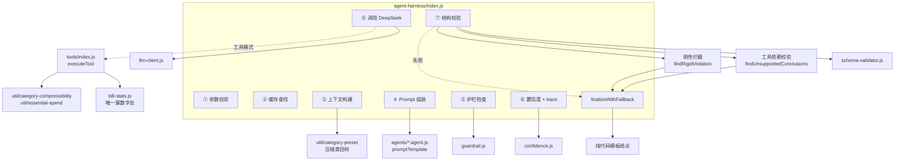

# 11 Agent Harness：LLM 调用链路

> 覆盖：Harness 8 步调用链 · 记账 agent · 分析 agent v3 · 11 个工具 · 工具依赖校验 · 工具循环协议 · 护栏 · 降级。
>
> 权威实现：`cloudfunctions/shared/agent-harness/`（index.js 781 行 / llm-client.js 536 行 / tools/index.js 609 行 / bill-stats.js 489 行）。

## 1. 总体结构



### 两个 Agent

| Agent | 文件 | 用途 | temperature | maxTokens | 工具 |
|---|---|---|---|---|---|
| `bill-parse` | `agents/bill-parse.agent.js` | 记账解析 | **0.1** | 800 | ❌ |
| `insight` | `agents/insight.agent.js` | 消费分析 v3 | **0.5** | 1400 | ✅ 11 个 |

`agent-harness/index.js` 的 `registerAgent` 默认预算：

```js
maxToolRounds: config.maxToolRounds || GUARDRAIL.ANALYSIS_MAX_TOOL_ROUNDS,  // 4
budget: { maxTokens: GUARDRAIL.MAX_INPUT_TOKENS,   // 1200 —— 仅当 agent 未声明 budget 时生效
          timeoutMs: GUARDRAIL.LLM_TIMEOUT_MS }     // 2200
```

> ⚠️ **注意 1200 是 fallback 默认值，不是 insight agent 的实际预算。**
> `insight.agent.js:62-65` 显式声明了 `budget: { maxTokens: 2400, timeoutMs: ANALYSIS_LLM_TIMEOUT_MS }`，
> **insight 的实际输入预算是 2400**。看到 1200 那个数字时不要误判。

**只有 analysis-svc 注册了 insight agent**；`asr-svc` / `category-svc` / `user-svc` 完全不用 agent，类别与业务规则都在 `rules/` 和 `util/` 层。

## 2. LLM 客户端

`agent-harness/llm-client.js`

```js
const DEEPSEEK_BASE_URL = 'https://api.deepseek.com/v1/chat/completions';
const MODEL = 'deepseek-chat';
```

> **只用 `deepseek-chat`，不用 `deepseek-reasoner`**。理由：记账要求端到端 ≤2.5s，reasoner 的延迟与成本都不适配；分析类任务通过 Prompt 分步拆解即可，无需深度推理。

| 项 | 值 |
|---|---|
| API Key 来源 | `process.env.DEEPSEEK_API_KEY` |
| 无 Key 行为 | `isMockMode()` → true → 直接返回 `{ ok:false, error:'NO_API_KEY', mock:true }` |
| 请求体固定字段 | `model, messages, temperature, max_tokens, stream:false, user` |
| JSON 模式 | 追加 `response_format: { type: 'json_object' }` |
| `user` 字段 | openid 哈希（`makeUserId` → `'u' + base36(hash)`），**不传原始 openid** |

**两个关键方法**：
- `chat({ messages, temperature, maxTokens, userId, jsonMode, timeoutMs })` —— 记账 agent 用
- `chatWithTools({ messages, tools, executeTool, maxRounds, timeoutMs, traceId })` —— 分析 agent 用

## 3. 记账 agent：bill-parse

### 3.1 输入输出

| 方向 | 内容 |
|---|---|
| 输入 | `asrText`（语音原文）+ 规则层解析参考 + 压缩类目树 |
| 输出 | `amount` / `categoryId` / `categoryCandidates` / `scene` / `note` / `account` / `date` |

### 3.2 Prompt 注入的三样东西

| # | 内容 | 来源 |
|---|---|---|
| 1 | **压缩类目树（带 ID）** | `category-preset.buildPromptCategoryTree()` |
| 2 | 规则层判定 | `category-match` 的结果 |
| 3 | 规则层解析参考 | `asr-parse` 的结果 |

### 3.3 ⚠️ 类目树必须带 ID

`util/category-preset.js` 的注释记录了一个实测教训：

> 「只给『买菜/肉蛋/水产』这样的**名称列表**时，模型会按 ID 命名规律自行推导出 `c5_4_1` / `c8_5_1` 这类不存在的 ID —— **实测幻觉率一度达 14%**」

所以 `buildPromptCategoryTree()` 输出的每个节点都**必须携带真实 ID**。

### 3.4 校验三级

`agent-harness/schema-validator.js` 的 `validate(rawOutput, schema, validCategoryIds)`：

| 阶段 | 检查 | 失败处理 |
|---|---|---|
| `json` | 能否剥 markdown 围栏 / 剥 JSON 前后散文 | 失败 → 修复重试（≤2 次）→ 仍失败走规则兜底 |
| `schema` | required / number(min,max) / enum / integer / boolean / array(min,max,items.required) | 同上 |
| `business` | 类目 ID 是否在合法清单里（**防幻觉**） | 同上 |

`buildRepairHint` 在 business 阶段附带**合法类目 ID 清单**（按输入文本关键词排序，最多 12 项）给模型参考。

## 4. 分析 agent：insight v3

### 4.1 v2 → v3 的变化

`agents/insight.agent.js` 头部注释原文：

> v2：建议受硬规则把关（占比 ≥15%、单类目 ≥3 笔、金额一律代码重算），结果是用户记 5 笔账、餐饮占 42.6%，却得到「暂时没有可优化空间」。
> v3：**规则全部拆除**。模型通过 `get_bills_detail` 拿到逐笔账单与频次统计，像消费顾问一样自由分析。

| 维度 | v2 | v3 |
|---|---|---|
| 建议生成 | 规则算占比 × 固定比例 | 模型基于明细自由分析 |
| 金额 | 代码算、模型转述 | 模型估、prompt 约束口径；纯定性建议 `amount` 可为 null |
| 规则建议 | 有 | **已删除**（`calcSavingsPotential` 一并移除） |
| 降级时 savings | 有模板建议 | **恒为空数组** |
| 轮次 | 3 | **4** |

### 4.2 buildContext 故意不注入账单数据

> ⚠️ 这里**故意不注入账单数据**。注入就等于给了模型算术的原料，它就会忍不住自己加总，而 LLM 的加总在几百笔规模下必然出错。数据只留在 tools 侧。

注入的只有三行元信息：
- `【统计月份】YYYY-MM`
- `【数据量】本月共 N 笔记录`
- `有 N 笔记录格式异常已被排除` / `上月没有记录，环比数据不可用，请不要描述涨跌`

### 4.3 输出 Schema

```js
{
  required: ['insights', 'savings'],
  insights: { type:'array', minItems:1, maxItems:5, itemType:'string' },
  savings:  { type:'array', maxItems:3, itemType:'object',
              requiredFields: ['title','action','trigger','reason','confidence'],
              optionalFields: ['category','amount'] }
}
```

`confidence` 是**必填**：有备注支撑填 `"high"`，仅基于类目与金额填 `"low"`。

### 4.4 Prompt 的五条铁律

| # | 铁律 | 要点 |
|---|---|---|
| 零 | **结论必须有工具支撑** | 附「你想说的结论 → 必须先调用」的映射表。**给建议前必须先调 `get_bills_detail`**。没工具支撑的结论会被系统丢弃 |
| 一 | **刚性支出的建议边界** | rigid：✗ 不给「少花点」「控制支出」，✓ 可以给「优化方式」（比价、降档、年付替代月付）。刚性占比高是正常的，如实说「可优化空间有限」即可。semi：可以提但克制，不建议「砍零」。flexible：这才是主要优化对象 |
| 二 | **备注是判断必要性的唯一直接证据** | 5 档：刚性关键词（不提建议）/ 社交必需（适度，不要说「少聚餐」）/ 自我提升（问必要性，不建议砍掉）/ 冲动可选（可明确建议）/ **无备注（允许给通用建议，但 confidence 填 "low"，reason 说明仅基于类目与金额）** |
| 三 | 建议视角 5 条 | 频次、品牌与档次、订阅审视、**单笔大额 ≠ 习惯**、社交与提升类支出不建议砍 |
| 四 | 金额规则 | amount 可选（可传 null，**不要硬造数字**）；是数字字符串如 `"115.00"`；不得超过该类目本月实际支出 |
| 五 | 允许返回空数组 | 「确实没有可优化点（如全部刚性）时，返回空 savings 并在 insights 里解释原因。**给错建议比不给更糟**」 |

### 4.5 消耗型参数的实际取值

| 参数 | 值 | 备注 |
|---|---|---|
| `maxToolRounds` | 4 | 模型会按类目多次调 `get_bills_detail` |
| `budget.maxTokens` | 2400 | 输入预算 |
| `budget.timeoutMs` | 20000 | `GUARDRAIL.ANALYSIS_LLM_TIMEOUT_MS` |
| `maxTokens`（输出） | 1400 | 实际 JSON 约 600~900 token。输出越大生成越慢、单轮超时风险越高（线上 trace 实测超时多发生在成文轮） |

## 5. 工具层

`agent-harness/tools/index.js`

### 5.1 11 个工具

| 工具 | 作用 | 入参 |
|---|---|---|
| `get_category_share` | 分类目占比 | — |
| `get_monthly_summary` | 总额/笔数/日均/最大单笔 | — |
| `get_month_over_month` | 环比 | — |
| `get_dining_structure` | 在家吃 vs 外出就餐 | — |
| `get_dining_detail` | 外出逐笔 + 最大单笔 | — |
| `get_top_categories` | Top N 类目 | `n` 1~5，默认 3 |
| `get_trend` | 多月趋势 | `monthCount` 3~12，默认 6 |
| `get_compressibility` | 刚性/半刚性/弹性分组 | — |
| `get_noted_bills` | 有备注的账单 | `limit` 5~50，默认 20 |
| `get_recurring_patterns` | 周期消费 | — |
| `get_bills_detail` | 逐笔明细（**给建议前必调**） | `limit` 10~100，默认 30 |

### 5.2 参数越界要报错，不能静默夹住

```js
validateArgs(name, args, schema)   // 报错回传模型
```

> 曾经的 `clampInt(args.n, 1, 5, 3)` 把 `999` 夹到 `5`、把 `'abc'` 当默认值 —— 模型会基于**错误理解的数据**下结论。改为报错后，模型能自我纠正（回传内容含「重新调用」）。

`TOOL_ARG_SCHEMAS` 只覆盖 5 个有可执行约束的工具。未知参数名会被 schema 拦下（`additionalProperties: false`）。

**日期由代码锁定** —— 工具参数里没有日期，月份由 `context.month` 注入。

### 5.3 工具报错必须回传模型

工具执行结果回传给模型的格式：

```js
// 成功
{ role: 'tool', tool_call_id: call.id,
  content: JSON.stringify(result.data) }

// 失败
{ role: 'tool', tool_call_id: call.id,
  content: JSON.stringify({ error: result.error }) }
```

> 不能吞掉。模型看到错误才知道「这个数据拿不到」，可以改为基于其他数据说话；**静默吞掉会让它在缺数据的情况下编结论**。

### 5.4 统计层是唯一算数字的地方

`agent-harness/bill-stats.js`（489 行，纯计算不碰 LLM）

| 函数 | 作用 |
|---|---|
| `normalizeBills(rawBills)` | 清洗：丢弃 `amount` 非正整数、`date` 不匹配 `YYYY-MM-DD` 的脏数据，返回 `{ bills, dropped }` |
| `calcCategoryShare(bills)` | 分类目占比 |
| `calcMonthOverMonth(cur, prev)` | 环比，**方向由代码判定** |
| `calcMonthlySummary(bills, month)` | 总额/笔数/记账天数/日均/最大单笔 |
| `calcTrend(billsByMonth, monthCount=6)` | 趋势，缺失月份补 0 |
| `calcTopCategories(bills, n=3)` | Top N |
| `calcDiningStructure` / `calcDiningDetail` | 餐饮结构 |
| `calcRecurringPatterns(bills)` | 周期消费检测 |
| `collectNotedBills(bills, limit=20)` | 有备注的账单 |
| `median(arr)` / `cv(arr)` | 中位数 / 变异系数（**已写好但闲置** —— PRD v3 的异常检测要用） |
| `centToYuanStr(cent)` | 分 → 元字符串 |

### 5.5 方向判断是代码的事

```js
if (deltaRate > 1) direction = 'up';
else if (deltaRate < -1) direction = 'down';
// ±1% 以内视为持平
```

> 避免「0.3% 的波动」被渲染成涨跌箭头。**±1% 一律 `flat`。**

### 5.6 周期消费判定阈值

```js
const MIN_OCCURRENCES = 3;
const WEEKLY_MAX_DAYS = 10;
const MONTHLY_MAX_DAYS = 40;
const AMOUNT_CV_MAX = 0.25;   // 金额变异系数
const GAP_CV_MAX = 0.4;       // 间隔变异系数
```

## 6. 工具依赖校验（结论的依据）

> ⚠️ 曾用「逐个数字查白名单」，**误伤率极高**（`'500.00'` vs `500` 格式差一位就整条作废），已废弃。
> 现改为：**模型不做数学，但获得「判断」的权力。**

### 6.1 映射表

`agent-harness/index.js:382` 的 `CONCLUSION_REQUIRES`：

| 维度 | 依赖工具 | 匹配模式（节选） |
|---|---|---|
| 类目占比 | `get_category_share` / `get_top_categories` / `get_bills_detail` | `占\s*\d`、`占比`、`大头`、`花得最多`、`排名` |
| 总额概览 | `get_monthly_summary` / `get_category_share` | `共\s*\d+\s*笔`、`日均`、`这个月花得` |
| 环比 | `get_month_over_month` | `比上月`、`环比`、`较上月` |
| 刚性支出 | `get_compressibility` | `刚性`、`生活必需`、`省不得`、`不该省` |
| 备注依据 | `get_noted_bills` / `get_bills_detail` | `备注`、`写着`、`显示是`、`买的是` |
| 消费频次 | `get_bills_detail` / `get_recurring_patterns` | `买了\s*\d+\s*次`、`频次`、`间隔` |
| 周期性消费 | `get_recurring_patterns` | — |

> **按语义关键词而非严格匹配**：结论是自然语言，不能要求模型标注用了哪个工具。启发式会有误判，但**误判方向是安全的** —— 判不出维度 → 放行；判出维度但没调工具 → 剔除（保守）。

### 6.2 判定规则

| 规则 | 说明 |
|---|---|
| **任一维度有支撑即成立** | 要求全部支撑会误杀复合结论 |
| **粒度是「单条结论」** | 不是整条作废。一条有依据 + 一条没依据 → 只剔没依据那条 |
| **完全没调工具** | insights 与 savings 都为空 → `NO_TOOL_GROUNDING` 退回兜底 |

### 6.3 刚性类目硬拦截

`findRigidViolation(data, toolContext, month)`：

判定同时看**类目名与备注** —— 模型可能写「控制住房成本」这种不含刚性类目名但实质指向房租的说法。

| 违规处理 | 行为 |
|---|---|
| 剔掉违规的那条 savings | 其余照常展示 |
| 剔完 insights 与 savings 都空 | `RIGID_CATEGORY_SUGGESTED` 退回兜底 |

## 7. 工具循环协议

`llm-client.js` 的 `chatWithTools`

### 7.1 预算分摊

```js
const perRoundTimeout = Math.max(800, Math.floor(timeoutMs / maxRounds));
```

`timeoutMs = 20000`，`maxRounds = 4` → **每轮 5000ms**。

> **v3 实测教训（2026-10-24 线上 trace）**：总预算 10s ÷ 4 轮 = 每轮 2500ms，对 function-calling 太紧 —— 最终成文轮要输出大 JSON 且上下文含账单明细，DeepSeek 响应轻松超 2.5s，**导致每轮必超时 → 永远走降级**。现给到 20s。

### 7.2 三条硬约束

1. **必须有 maxRounds** —— 模型可能反复请求同一个工具（实测不会自己停）
2. **每轮独立超时** —— 不能用一个大 timeout 覆盖整个循环
3. **工具报错要回传给模型** —— 不能吞掉

### 7.3 消息序列

```
system
→ assistant { tool_calls: [...] }
→ tool { tool_call_id, content }
→ assistant { tool_calls: [...] }
→ tool { ... }
→ assistant { content: 最终 JSON }
```

**token 跨轮累计** —— 否则成本统计严重低估。

### 7.4 轮次用尽

```js
error: `工具调用轮次达上限（${maxRounds}），模型未给出最终结论`
```

## 8. 护栏

`agent-harness/guardrail.js`

| 函数 | 作用 | 状态 |
|---|---|---|
| `desensitize(text)` | 手机号/身份证/银行卡掩码 | ✅ 在用 |
| `checkContentSafety(text)` | 提示词注入正则（`ignore previous`、`忽略以上`、`system prompt`、`<script>`） | ✅ 在用 |
| `estimateTokens(text)` | CJK×1.5 + 其余/4 | ✅ 在用 |
| `trimByPriority(blocks, maxTokens)` | 按优先级裁剪：`p3_samples` → `p2_recent` → `p1_aliases` → `p1_categoryTree`，**`p0_system` 永不丢** | ✅ 在用 |
| `checkTokenBudget(usedTokens, dailyBudget)` | 成本熔断 | ✅ 在用 |
| `validateAmountGuard(cent)` | 金额护栏 | ❌ **死代码**（全项目零调用） |
| `validateNumericCitations(text, values)` | 数值对账 | ❌ **已移除调用**（死代码） |

> `validateNumericCitations` 的移除原因（`agent-harness/index.js:225-235` 原文）：「实测误伤率极高（格式差一位就整条作废）……`options.authoritativeValues` 全项目无人传入，所以这段原本就是死代码」。

## 9. 降级

### 9.1 统一终点

`finalizeWithFallback(agent, input, options, traceId, reason)` → 返回 `ok: true`（业务链路是通的）+ `isFallback: true` + `fallbackReason`。

### 9.2 13 个降级原因码

`util/fallback-reason.js` 的 `REASONS`：

| 原因码 | 触发条件 | level |
|---|---|---|
| `NO_API_KEY` | 未配 `DEEPSEEK_API_KEY` | `config` |
| `MOCK_MODE` | mock 模式 | `config` |
| `GLOBAL_LLM_DISABLED` | `LLM_ENABLED=false` | `config` |
| `TOKEN_BUDGET_EXCEEDED` | 日 token 预算耗尽 | `retry` |
| `TOOL_LOOP_ERROR` | `chatWithTools` 抛异常 | `retry` |
| `LLM_UNAVAILABLE` | 最后一轮 `!ok`（网络/超时） | `retry` |
| `GUARDRAIL_CONTENT_SAFETY` | 内容安全拦截 | `guard` |
| `VALIDATION_FAILED` | 三级校验失败 | `retry` |
| `NUMERIC_CITATION_MISMATCH` | 旧数值对账（**已废弃**，仅留表） | `guard` |
| `NO_TOOL_GROUNDING` | 剔无支撑结论后全空 | `guard` |
| `RIGID_CATEGORY_SUGGESTED` | 剔刚性违规后全空 | `guard` |
| `INVOKE_FAILED` | `res.ok && res.data` 不成立 | `retry` |
| `EXCEPTION` | catch 到异常 | `unknown` |

> ⚠️ 代码注释写「12 种」，实际 `REASONS` 表有 **13** 个键。

### 9.3 三档语义 —— 区分「故障」与「保护」

| level | 含义 | 用户能做什么 |
|---|---|---|
| `config` | 配置问题 | **直接解决**：配 Key、打开开关 |
| `retry` | 临时故障 | 稍后重试 |
| `guard` | **护栏正常工作，不是故障** | 什么都不用做 |

> ⚠️ 曾经的坑：把「护栏拦下了不该出的结论」显示成错误，用户以为系统坏了。`guard` 档前端用**中性样式**而非错误样式。

### 9.4 三级降级链

| 级 | 位置 | 产出 |
|---|---|---|
| 1 | harness 层 `agent-harness/index.js` | 调 `agent.fallback()` |
| 2 | agent 层 `insight.agent.js` | 纯代码模板结论（6 条 insights），**`savings` 恒为 `[]`** |
| 3 | analysis-svc 层 `buildFallbackInsights` | 极端兜底，用 `billStats` 拼 2 条结论 |

### 9.5 v3 降级语义的关键变化

> v3：规则全部拆除。……降级时 savings 恒为空数组，analysis-svc 会把 `meta.savingsSource` 标记为 `'unavailable'`，前端据此显示「AI 分析暂不可用」+ 重试按钮，**而不是用规则建议冒充 AI 结论**。

## 10. 前端如何呈现降级

`pages/analysis/analysis.js` 的 `buildSavingsEmpty(savings, meta, insights)` —— **严格区分三种「无建议」**：

| 情况 | 判据 | 文案 | 重试按钮 |
|---|---|---|---|
| ① AI 没跑成 | `meta.savingsSource === 'unavailable'` | 「AI 分析暂不可用」+「省钱建议由大模型生成，本次未能完成」 | ✅ 有 |
| ② AI 跑过但没空间 | insights 含「可优化空间有限 / 以刚性支出为主 / 都是刚性 / 数据还太少」 | 「暂时没有可优化空间」+ 复用后端说法 | ❌ |
| ③ 有数据但信息少 | `meta.billCount > 0` | 「暂时没有可优化空间」+「多记几笔、备注写清楚消费用途，建议会更具体」 | ❌ |

**空卡片同样有害** —— 用户会以为「我没有可优化的地方」。

## 11. 可观测性

`agent-harness/tracer.js`

| 项 | 值 |
|---|---|
| traceId | `crypto.randomBytes(8).toString('hex')` |
| 缓冲区 | `MAX_BUFFER = 200`，`MAX_CHAINS = 50` |
| 输入哈希 | `hashInput` —— sha256 前 16 位，**不存原文** |
| 详细模式 | `process.env.DEBUG_TRACE === 'true'` |
| 始终打印的事件 | `fallback_error`、`rigid_category_violation`、`numeric_mismatch` |
| 输出 | 结构化事件只进内存链，结束时**统一 dump 一次**（不重复输出） |

**埋点不能成为故障源**：`safeStringify` 对循环引用返回占位符而非抛错；超长数组被截断。

详见 `engineering/21-debugging.md`。
